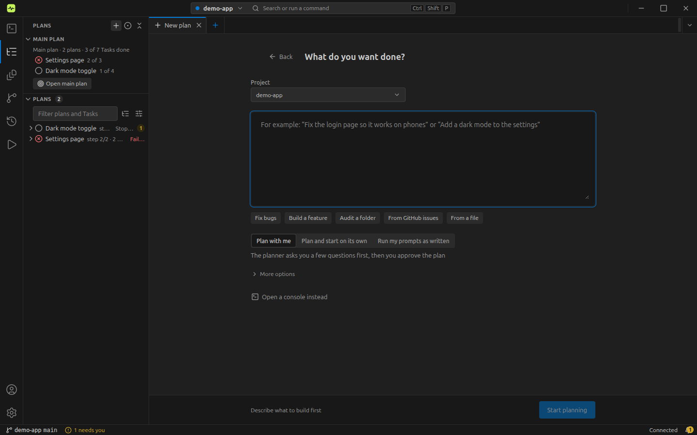
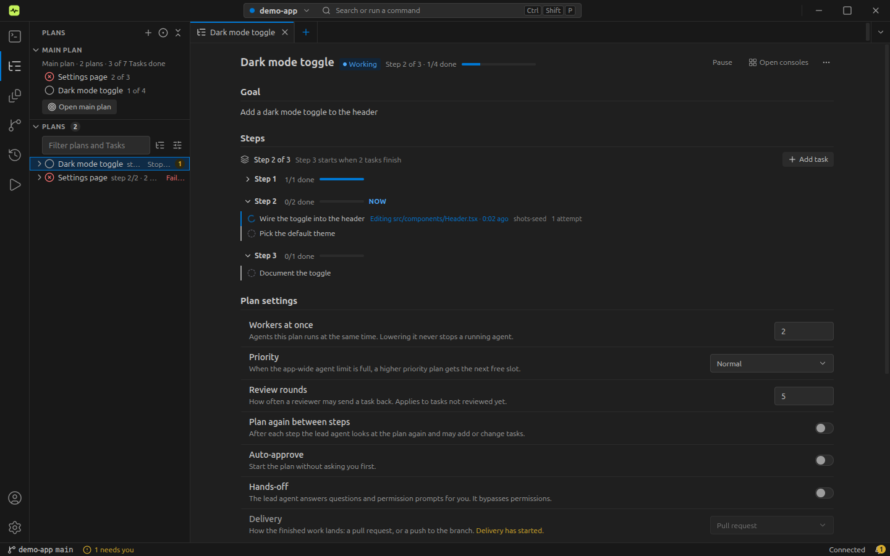
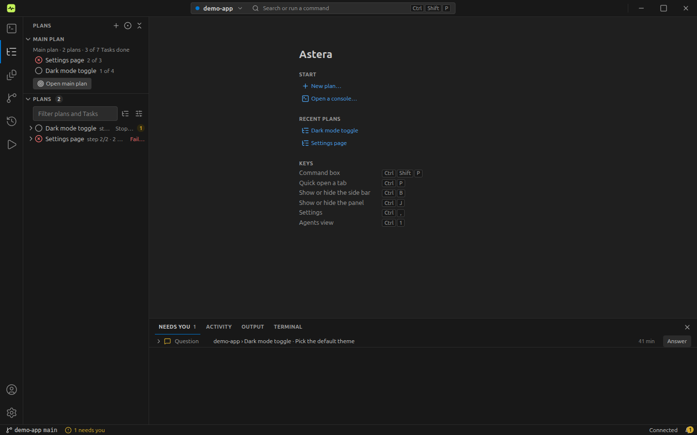
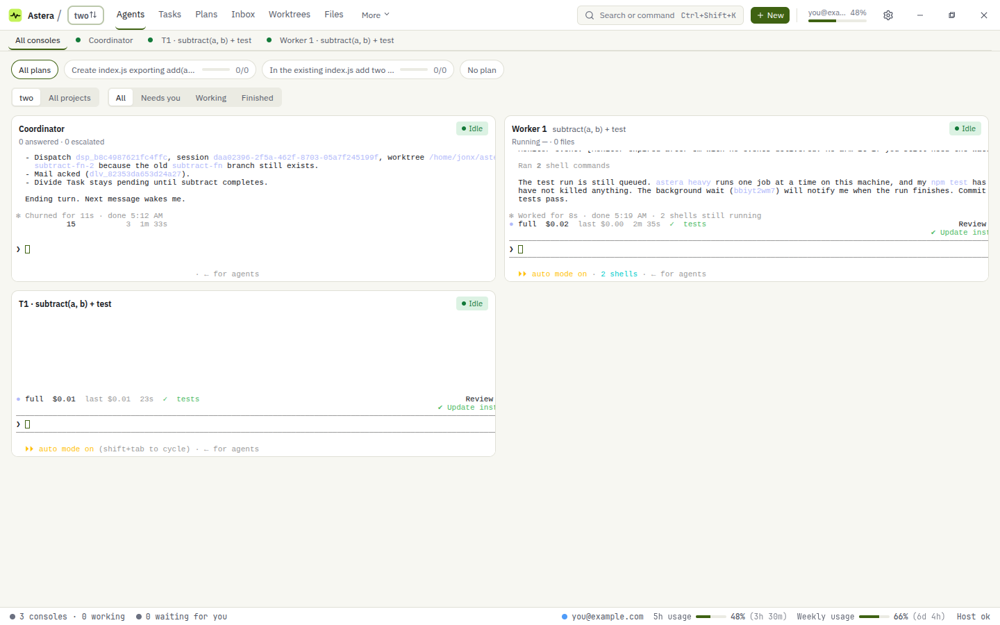

<div align="center">

# Astera

**Hand it a plan. It runs the agents. It asks you only when it must.**

[](LICENSE)


[How it works](#how-it-works) · [Run it](#run-it) · [What it does](#what-it-does) · [The `astera` command](#the-astera-command) · [Docs](#documentation)


</div>

Astera is a desktop app that runs many Claude Code and Codex terminals for you. You give it a goal or a source (an
issue, a folder of written plans), a planner splits it into Tasks, and workers run them in parallel, each on the right
model. A reviewer checks every Task, the plan ends as a pull request or a push, and Astera asks you only when it must.

Every agent is a real `claude` or `codex` terminal, never an imitation of one. You can watch any of them and type into
any of them without stopping the rest.

## How it works

1. **Add a project.** A project is one git repository. Add an existing folder or create a new one, optionally with a
   GitHub repository.
2. **Start a plan.** **New → Plan it for me** opens the Start tab: write a goal, pick GitHub issues, audit a path, or
   attach your own files. **Run as written** turns each prompt file (or each `##` section of one document) into one
   Task with its text unchanged.

   

3. **Approve or talk.** The plan lands in the bottom panel's **Needs you** tab. Read the Tasks, then press **Approve & execute**. Or tell the
   planner what to change and it replans. Turn on auto-approve for a project to skip this step.
4. **Watch it run.** The **Agents** view lists every console, and the **Wall** tab shows them all at once as live tiles. A coordinator places workers as their
   dependencies finish. Tasks that touch the same files never run at the same time, not even across plans. Between
   waves a fresh planner adjusts what has not started yet. After the last wave a final check compares the result with
   the goal.

   

5. **Answer in Needs you.** Permission prompts, questions Astera cannot answer itself and failed reviews wait in one
   place, with a sound and a desktop notice. Everything Astera did without you is listed beside them.

   

6. **It delivers.** Per project: **pr** opens one pull request per plan and never merges it. **push** merges into the
   delivery branch and pushes it, after the reviews, the final check and the tests pass. It stops and asks when
   anything is off, and never force-pushes.

Before planning, the planner checks what already exists: the code, GitHub issues and pull requests, and your other
plans. Nothing gets built twice.

## Run it

Linux is the platform it is built and tested on. You need:
- Node ≥ 22.13, `python3`, `make` and `g++` (`node-pty` is compiled on install);
- the `claude` CLI on your `PATH`, and `codex` if you use Codex;
- `gh`, signed in, for pull requests.

```bash
git clone https://github.com/JanoTheDev/astera-orchestrator.git astera && cd astera
npm ci
npm run dist:linux                         # builds dist-installer/astera-*-x86_64.AppImage
./dist-installer/astera-*-x86_64.AppImage  # profile: ~/.config/astera
```

`npm run dev` runs the development app on its own profile (`~/.config/astera-dev`).

First run:
1. **Settings → Accounts & usage → +**: add one or more Claude or Codex accounts and sign in.
2. **Settings → Agents → Orchestration models**: the model per role. Defaults: planner and reviewer `opus`,
   coordinator `haiku`, workers by Task difficulty (light `haiku`, standard `sonnet`, hard `opus`).
3. **Settings → Integrations → CLI → Install the astera command**.
4. Set a git identity (`git config --global user.name` / `user.email`).

Agents stop at every permission prompt until you answer it. Turn that off only for repositories you trust:
**Settings → Agents → Run agents without permission checks**.

## What it does

Astera is a VSCode-style workbench. The **activity bar** on the left switches the side bar between six views: **Agents ·
Plans · Explorer · Source Control · History · Run** (`Ctrl+1…6`). The side bar is resizable (`Ctrl+B` hides it).
Consoles, files, plans, settings and worktrees open as **tabs** in editor groups that you can split. The **bottom
panel** (`Ctrl+J`) has **Needs you · Activity · Output · Terminal** tabs. The status bar shows the project, branch,
working and needs-you counts, account usage, the Host state and the notification bell. `Ctrl+Shift+P` opens the
command palette.

**Agents.** The Agents view lists the project's consoles by state (Needs you, Working, Finished). The **Wall** tab shows
every console at once, as live tiles of the real terminals. Click one to open it in its own tab and type into it. While you type, the coordinator's messages to that console wait, so they never land in the middle of
your line. A finished console leaves a short summary card of what it did.



**Plans.**
- The Plans view is a tree of plan, step and Task. Group it by plan, status or area; plans that touch the same files are flagged.
- Per-role models: coordinator, planner, workers and reviewer each run on their own model.
- One app-wide cap on workers (1 to 100, set in Settings › Agents). Plans with a higher priority get the next free slot.
- Wave replanning, a reviewer on every Task (up to 5 rounds) and a final check against the goal.
- Pause or stop a plan or one worker. Rename, archive and unarchive plans. Queue a plan behind another.
- Per plan, in its own tab: goal, steps, and Log, Changes (who wrote each line, agent or human), Files and "Talk to the plan".
- **Change a running plan** in the plan tab's **Plan settings** (also **Edit plan settings…** in the Plans view's context
  menu): workers at once, priority, review rounds, planning again between steps, auto-approve, hands-off and delivery.
  Changes save as you make them and apply to agents that start from then on.
- Usage guards: no new worker starts on an account near its limit (90% by default); it starts on the next account.

**Needs you.** The bottom panel's **Needs you** tab lists what needs you, with a feed of what Astera handled without
you. The bell in the status bar shows the same at a glance. Agents can never approve a plan or answer a permission
prompt. Only you can.

**Source Control and Explorer.**
- One git worktree per worker, under `~/astera-worktrees/<repo>/`. Astera merges finished Tasks itself and cleans up
  the worktrees of a delivered plan.
- Source Control lists the worktrees and their changes. The Explorer view has the file tree, an editor, side-by-side markdown, and local history before every delete.
- GitHub: issues and pull requests linked to plans and Tasks.

**Accounts and windows.**
- Several accounts per vendor, each isolated in its own `CLAUDE_CONFIG_DIR` / `CODEX_HOME`.
- **Account rolling:** when a session hits a usage limit, Astera reads the reset time and resumes the work on the
  next account.
- One window per project, side by side. The Host owns every session, so closing a window stops nothing.

**Reach it from anywhere.**
- The `astera` command, an MCP server and a TypeScript SDK all drive the same Host.
- Plugins run beside the Host as job sources and notifiers ([docs/plugins.md](docs/plugins.md)).
- **Remote runtimes**: run sessions and plans on another machine over your own LAN, VPN or Tailscale. The remote
  Runtime owns the agents, worktrees, checks and recovery, so work keeps going while your client is away.
  No Astera relay or cloud service is required. See [docs/remote-runtime.md](docs/remote-runtime.md).

**Safe by default.**
- Auto-update and the remote policy are off unless built with `ASTERA_AUTO_UPDATE=1`.
- Agents ask before every permission prompt, and the bypass is off unless you turn it on.

## The `astera` command

It talks to the Host, so it works with the app open or closed:

```bash
astera projects add --path ~/code/app                            # a git repository becomes a project
astera jobs create --objective "…" --cwd ~/code/app --attach plan.md
astera jobs plan --id <jobId>                                    # the planner writes the Tasks
astera jobs run --id <jobId>                                     # approve and start
astera questions list --status open                              # what is waiting on you
```

Everything else is in [docs/cli.md](docs/cli.md).

## Where it is going

Still ahead: **Run as written by name**, so you write the prompt names in the Start box and Astera finds the files
instead of you attaching them. The decided plans and the contracts are in [docs/dev/PLAN.md](docs/dev/PLAN.md).

## Documentation

- [Product docs](docs/product/): features, known limits (platforms, tools, network, open gaps) and the licensing seam.
- [User guide](docs/guide.md): projects, plans, approval, the Agents, Plans and Source Control views, Needs you, delivery.
- [Everyday usage](docs/usage-guide.md): sessions, accounts, files, recovery and settings.
- [Jobs](docs/jobs.md): what a plan does from creation to delivery, and scheduled jobs.
- [How It Works](docs/how-it-works.md): explanations of finished work.
- [The `astera` command](docs/cli.md), [MCP](docs/mcp.md), [SDK](docs/sdk.md), [Plugins](docs/plugins.md).
- [Remote runtimes](docs/remote-runtime.md), [Slack bot](docs/slack-bot-setup.md), [Telegram bot](docs/telegram-bot-setup.md).
- [Linux](docs/dev/LINUX.md): prerequisites, what is verified, known issues.
- For contributors: [plan](docs/dev/PLAN.md), [spec](docs/dev/SPEC.md), [context](docs/dev/CONTEXT.md),
  [design](docs/dev/DESIGN.md), [wave prompts](docs/dev/prompts/README.md), [releasing](docs/releasing.md),
  [CONTRIBUTING](.github/CONTRIBUTING.md).

## Credits

Astera started as a fork of [parsingk/Astera](https://github.com/parsingk/Astera) and has diverged from it since.
The coordinator-and-workers model takes its cues from [Orca](https://github.com/stablyai/orca)'s agent
orchestration. The implementation is our own.

## License

[Apache License 2.0](LICENSE).
