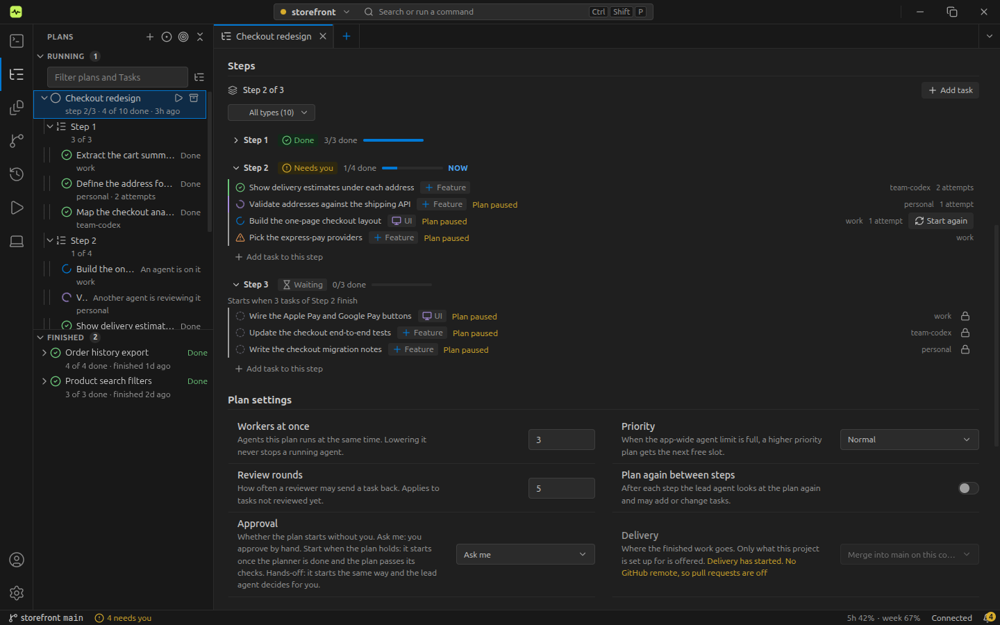
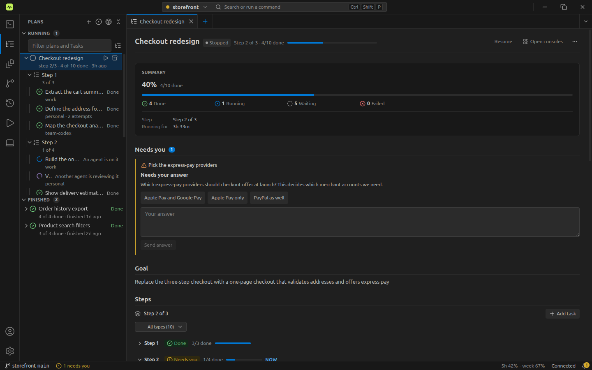
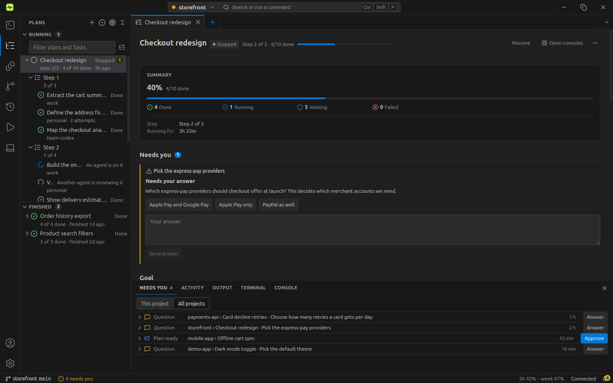
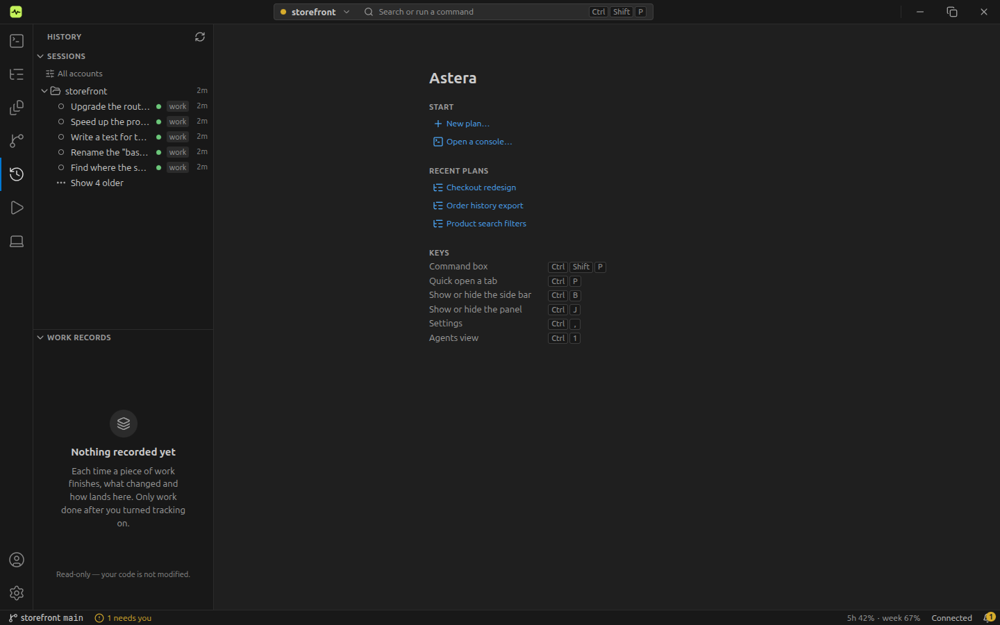
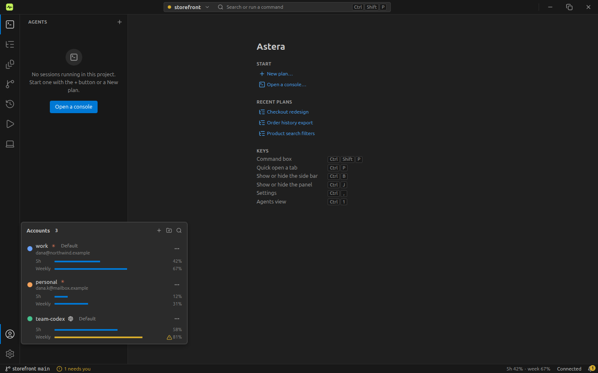

# Astera documentation

Astera is a desktop app that runs many Claude Code and Codex terminals for you: a planner splits a goal into Tasks,
workers run them in parallel, a reviewer checks each one, and the plan ends as a pull request or a push. These pages
explain how to use it, how it works, and how to drive it from code. The [project README](../README.md) has the short
version.

## Start here

| [Getting started](getting-started.md) | [Concepts](concepts.md) | [User guide](guide.md) |
| --- | --- | --- |
| Install, first run and your first delivered plan | Projects, plans, Tasks, consoles, the Host | Every view and setting, day to day |

## Use Astera

- [Getting started](getting-started.md): from install to the first delivered plan, with screenshots.
- [User guide](guide.md): the workbench view by view, Start, approval, Needs you, delivery, worktrees, Settings.
- [Usage guide](usage-guide.md): task-oriented recipes for common jobs.
- [Jobs](jobs.md): plans on a schedule and plans started from a shell.
- [How it works](how-it-works.md): what happens between your goal and the delivered result.
- [Troubleshooting](troubleshooting.md): symptoms and fixes.

## Understand it

- [Concepts](concepts.md): the words the app and these pages use.
- [Architecture](architecture.md): the app window, the Host, the CLI, MCP and SDK, agent terminals and worktrees.
- [Agent workspace isolation](agent-workspace-isolation.md): a design brief on keeping agents apart; nothing in it is decided yet.
- [Known limits](product/known-limits.md): what Astera does not do yet.
- [Features](product/features.md) and [licensing](product/licensing.md): what the product contains and how it is licensed.

## Drive it from code

- [`astera` command](cli.md): the command-line reference.
- [MCP server](mcp.md): `astera mcp serve`, for agents that plan and dispatch through Astera.
- [SDK](sdk.md): `@astera-app/client`, the typed client.
- [Plugins](plugins.md): the plugin author's guide.

## Run it elsewhere

- [Remote runtime](remote-runtime.md): run the Host on another machine.
- [Slack bot setup](slack-bot-setup.md)
- [Telegram bot setup](telegram-bot-setup.md)
- [Discord bot setup](discord-bot-setup.md)

## Contribute

- [Contributing](../.github/CONTRIBUTING.md): repo rules, commits, tests.
- [Releasing](releasing.md): how a release is cut.
- [`dev/`](dev/): the Linux notes, design notes and the plan behind this fork.

## Gallery

<table>
  <tr>
    <td width="50%"> Plans tree and plan tabs: <a href="guide.md#while-it-runs">While it runs</a></td>
    <td width="50%"> Needs you: <a href="guide.md#needs-you">the guide</a></td>
  </tr>
  <tr>
    <td width="50%"> History: <a href="guide.md">the guide</a></td>
    <td width="50%"> Accounts and usage: <a href="getting-started.md#2-first-run">Getting started</a></td>
  </tr>
</table>
