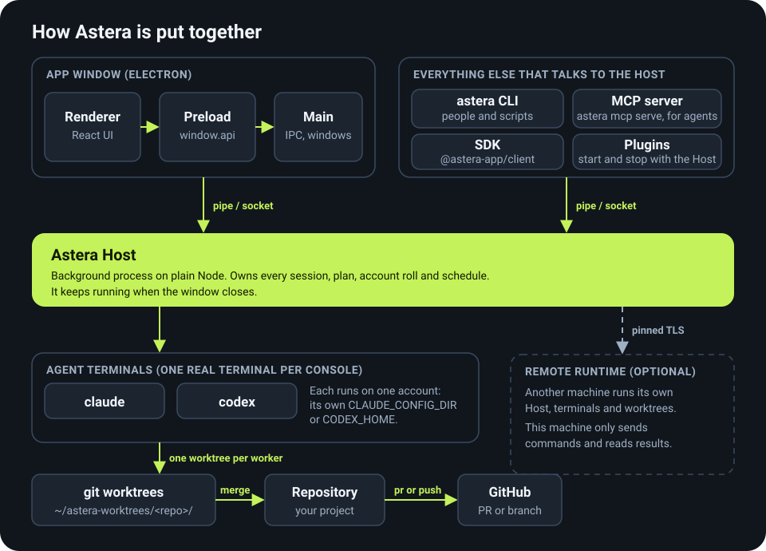
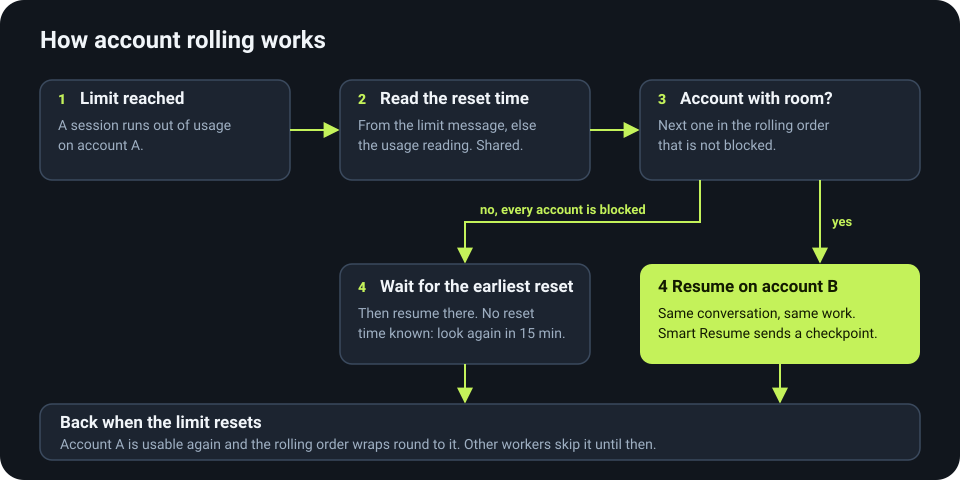

# How Astera is put together

This page is the map: which processes exist, who owns what, how a plan moves from a goal to a delivered pull request,
how Astera moves work between accounts, and where everything is stored. It names real parts only. For the day-to-day
side see the [user guide](guide.md); for the mechanics of one Job see [Jobs](jobs.md).

## Processes and who owns what

**The Host owns the work.** The Astera Host is a background process on plain Node. It runs every console (one real
`claude` or `codex` terminal each), drives every plan, rolls accounts, fires schedules and writes the activity feed. The
window is one client of it, so closing the window stops nothing. Nothing the Host imports may reach Electron, `src/main` or
`src/renderer`: `src/host/importFence.test.ts` fails the build if it does.

**Five ways in, one Host behind them.** They all reach the same Host over its own pipe or socket, so a Job made in one
shows up in all of them:

| Client | What it is for | Page |
|---|---|---|
| The app window | The workbench: renderer (React UI), preload (`window.api`) and main (IPC handlers and wiring) | [guide.md](guide.md) |
| `astera` CLI | People and shell scripts | [cli.md](cli.md) |
| MCP server | `astera mcp serve`, for agents that make and watch Jobs | [mcp.md](mcp.md) |
| SDK | `@astera-app/client`, for applications and integrations | [sdk.md](sdk.md) |
| Plugins | Node programs the Host starts and stops with itself; they reach it through `ctx.astera`, an SDK client | [plugins.md](plugins.md) |

**Workers never touch your project folder.** Each worker runs in its own git worktree under
`~/astera-worktrees/<repo>/`. When a Task's work is finished its worktree is merged into the plan's worktree, and the
plan is delivered as a pull request or a push ([delivery](#delivery)). The coordinator and the planner read your project
but never edit it.

**Accounts are isolated.** Each Claude account has its own `CLAUDE_CONFIG_DIR` and each Codex account its own
`CODEX_HOME` (`src/core/accounts/`), so every console runs as one account and keeps that account's own limits.

**An optional remote runtime.** With [Remote Runtime](remote-runtime.md) another machine runs the Host, terminals and
worktrees, and the machine you type on only sends commands and reads results. The link is pinned TLS with a one-time
pairing; use a private network.

## The plan lifecycle

A **plan** is a Job: a goal cut into **Tasks**. Four roles run it, each a separate console:

1. **Planner.** Reads the code, the issues and the project's other plans, then writes the Tasks. Its result lands in
   the **Needs you** tab as "Plan ready".
2. **You approve.** Press **Approve & execute**, ask the planner for changes, or reject. Auto-approve skips the step. An
   agent session can never approve. See [Approve it, or talk to the planner](guide.md#approve-it-or-talk-to-the-planner).
3. **Coordinator.** Places a worker for every Task whose dependencies are done, and answers workers' questions. It plans
   and places; it never edits files.
4. **Workers.** One console per Task, each in its own worktree. Tasks of one wave run side by side. A Task counts as done
   on the worker's explicit report plus any checks, not on a quiet terminal.
5. **Reviewer.** A fresh reviewer checks every Task. A blocking finding goes back to the worker for up to 5 rounds, then
   the Task escalates.
6. **Replan.** A wave is a Task's dependency depth. At each boundary a fresh planner adjusts the Tasks that have not
   started; it never touches a running or finished one.
7. **Final check.** After the last wave the planner checks the result against the goal and may add up to 3 follow-up
   waves.
8. **Delivery.** See below.

### Where Astera asks you

The amber marks in the diagram are items in the bottom panel's **Needs you** tab: a plan waiting for approval, a Task
that ran out of attempts or review rounds, a plan that no longer holds together after replanning, and a push that
finds a dirty folder, the wrong branch or a conflict. Hands-off plans put no card there; their coordinator answers
instead. Details are in [Needs you](guide.md#needs-you).

### Delivery

- **`pr`** (the default): one pull request per plan. Astera never merges it. With no remote, the work stays on the plan's
  branch.
- **`push`**: Astera merges the plan's worktrees into the delivery branch, runs the checks once more and pushes. It stops
  and asks instead of touching a dirty folder, the wrong branch or a conflict.

The full rules are in [Delivery](guide.md#delivery) and [Jobs](jobs.md#4-when-it-is-done-delivery-or-a-merge-you-press).

## Account rolling

You give a session an order of accounts. When an account reaches its usage limit, Astera does not stop the work:

1. It detects the limit in the session's output and reads the reset time from the message. When the message carries
   none it uses the account's usage reading, and when neither is known it looks again after 15 minutes.
2. It records that the account is blocked until then. The record is shared, so other workers rolling through the same
   accounts skip it without hitting the limit themselves.
3. It resumes the same conversation on the next account in the order that is not blocked. With **Smart Resume**
   (Settings → Agents) the new session gets a compact checkpoint instead.
4. When every account is blocked it waits for the earliest reset, plus a minute of margin, and resumes there.
5. When a limit resets, that account is usable again and the order wraps round to it.

The logic lives in `src/core/rolling/` (`detect.ts` finds the limit, `resetTime.ts` reads the reset, `retry.ts` picks the
account and plans the wait). The Host acts on a rolling chain only while no older app instance is also rolling it, so one
chain is never rolled twice (`src/core/host/rollOwner.ts`). Separately, a **usage guard** (default 90%) holds new workers
back from an account near its limit; it never stops a running worker. See [accounts and rolling](usage-guide.md#use-multiple-accounts).

## Where state lives

Astera keeps its state in the **profile folder**, and the work itself in worktrees:

| Where | What |
|---|---|
| `~/.config/astera` on Linux, `~/Library/Application Support/astera` on macOS, `%APPDATA%\astera` on Windows | The profile folder. `npm run dev` uses a separate `astera-dev` profile next to it. `ASTERA_PROFILE_DIR` overrides it. |
| `<profile>/host/` | The Host: `host.log`, its pid file, its key, and the sessions it holds live |
| `<profile>/rolling.log` | Account rolling decisions |
| `<profile>/orch/` | Orchestration records, including the activity feed `activity.jsonl` |
| `<profile>/accounts.json`, `<profile>/account-usage.json` | Registered accounts and their last usage readings |
| `~/astera-worktrees/<repo>/` | One worktree per worker and per plan, created when the first worker is placed |
| Your project folder | Untouched by workers until you merge or a delivery lands |

The profile is also where a bug report's logs come from: see [Reporting a bug](../.github/CONTRIBUTING.md#reporting-a-bug).

## Source layout

The folders are `src/core` (logic with no Electron in it), `src/main`, `src/renderer`, `src/preload`, `src/host`
and `src/cli`; plugins run from `src/pluginHost` and the SDK is `packages/client`. The
[Where things live](../.github/CONTRIBUTING.md#where-things-live) table in CONTRIBUTING says what each one is and what it may
import.

## Related pages

[CLI reference](cli.md) · [MCP](mcp.md) · [SDK](sdk.md) · [Plugins](plugins.md) · [Remote Runtime](remote-runtime.md) ·
[Jobs](jobs.md) · [User guide](guide.md)
