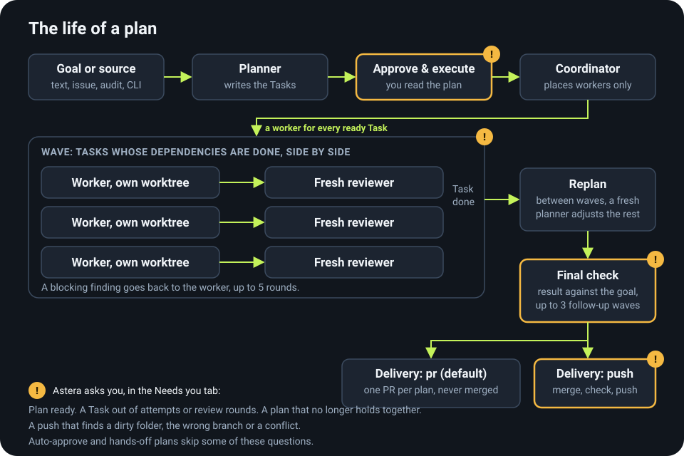
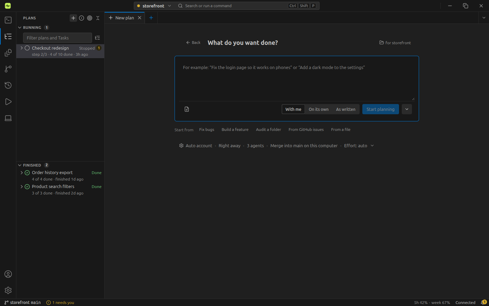
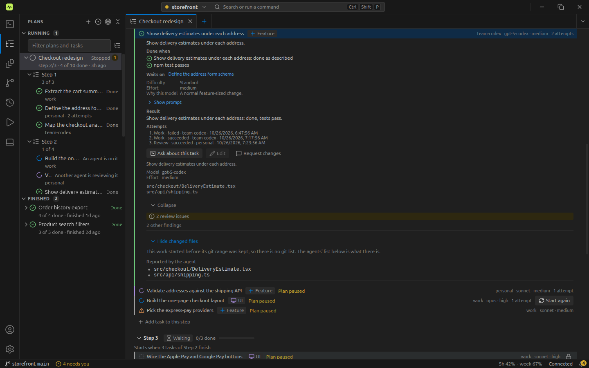
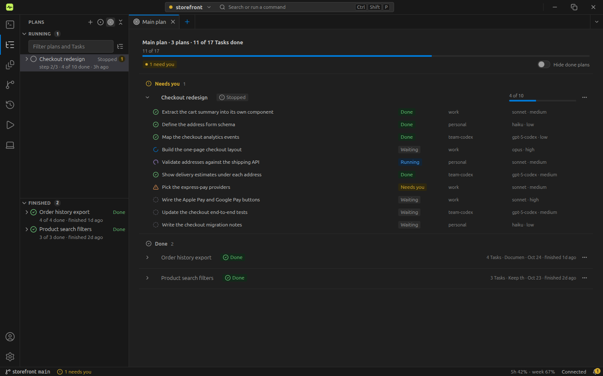
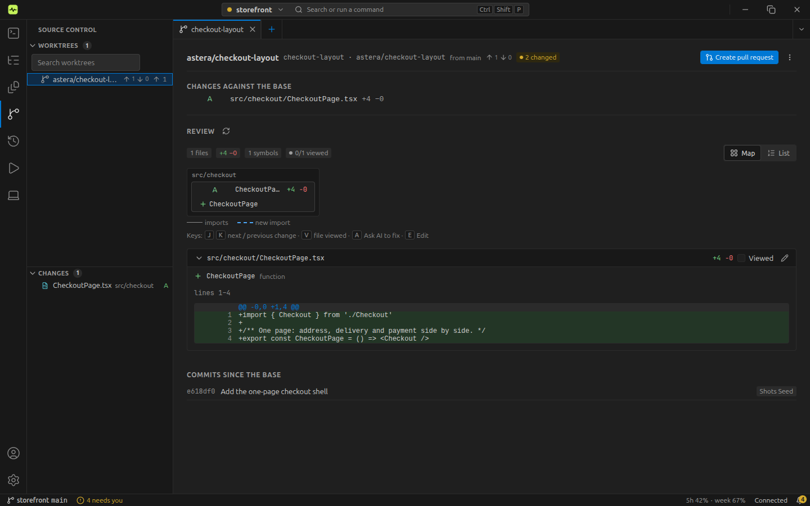
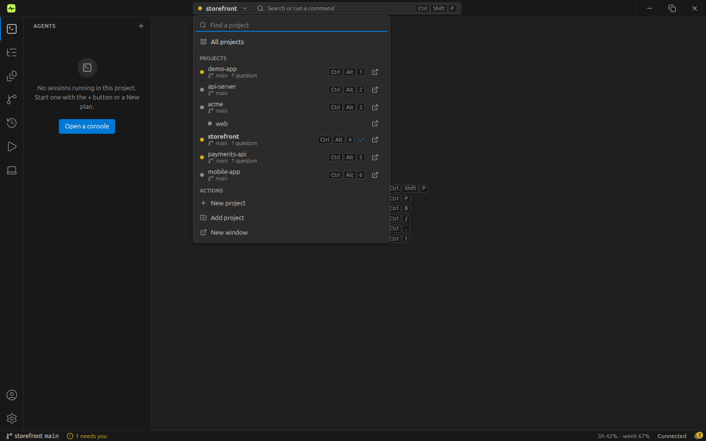
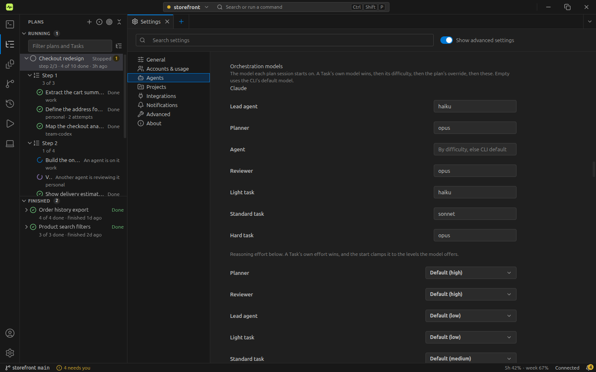

# Astera user guide

How to work with Astera day to day, view by view. A **project** is a git folder. A **plan** is a Job: a goal cut into
**Tasks**. Each attempt at a Task is one real `claude` (or `codex`) terminal, a **console**. Four roles run them: the
**planner** writes the plan, the **coordinator** places workers and answers their questions, **workers** do the Tasks
and a **reviewer** checks each one. The background **Host** owns every console and drives every plan, so closing the
window stops nothing ([Linux notes](dev/LINUX.md), "Closing the window").

More: [Getting started](getting-started.md) · [Concepts](concepts.md) · [Troubleshooting](troubleshooting.md)



Astera is a VSCode-style workbench:

- **Activity bar** (far left): **Agents · Plans · Explorer · Source Control · History · Run · Devices**, then Accounts and
  Manage at the bottom. `Ctrl+1…6` open the first six views (Devices has no default key). Clicking the active one hides the side bar.
- **Side bar**: the open view's lists. Drag its edge to resize it; `Ctrl+B` shows or hides it.
- **Editor groups with tabs**: consoles, files, plans, Settings, worktrees and Start open as tabs. Split the
  area to keep two side by side. The Welcome tab shows when nothing is open.
- **Bottom panel** (`Ctrl+J`): **Needs you · Activity · Output · Terminal**. It never opens by itself.
- **Status bar**: project and branch, how many consoles work and need you, account usage, the Host state and the
  notification bell.
- **Command palette** (`Ctrl+Shift+P`, or the search field in the title bar) and quick open (`Ctrl+P`: tabs, plans,
  files). `Ctrl+,` opens Settings and `Ctrl+N` opens New. Rebind any of these in the Keyboard Shortcuts tab, from the Manage menu or the command palette.

**Start** opens from New, from the Plans view's **New plan**, and by itself when a project has nothing yet.

- [Before the first plan](#before-the-first-plan)
- [Start: make a plan](#start-make-a-plan)
- [Approve it, or talk to the planner](#approve-it-or-talk-to-the-planner)
- [While it runs](#while-it-runs): Agents, Tasks, Plans
- [Needs you](#needs-you)
- [Delivery](#delivery)
- [Worktrees](#worktrees) (Source Control)
- [Projects and windows](#projects-and-windows)
- [Settings](#settings)
- [The box and voice](#the-box-and-voice)
- [Running Astera on its own repository](#running-astera-on-its-own-repository)

## Before the first plan


- **Sign in an account.** Click the account usage in the status bar, or the Accounts button at the bottom of the activity bar or open Settings → Accounts &
  usage → **+**, pick Claude or Codex and a name, then **Add account**. Astera runs the CLI's own login for the new
  account's folder (`claude auth login` / `codex login`) and shows the sign-in link in a small dialog with **Open in
  browser** and **Copy**. Sign in in the browser; if it shows a code, paste it into the dialog's code box. The dialog
  closes by itself once the account reads as logged in. A row that is not logged in has a **Sign in** button. Hover a
  row for **×** (Remove), with "Also log out". Double-click a name to rename it. The link is held only in memory,
  never logged or stored.
- If you re-log an account's folder as someone else (`claude /login` in `~/.claude`), the row follows at the next
  login check (when the window gets focus): its label becomes the new email, unless you renamed it, and the old
  person's usage reading is dropped.
- **Settings → Agents → Orchestration models**: the model of each role (Planner, Lead agent, Agent, Reviewer).
  Defaults: planner and reviewer `opus`, lead agent (the coordinator) `haiku`, agents (workers) by Task difficulty
  (light → haiku, standard → sonnet, hard → opus). Empty means the CLI's default model.
- **Settings → Agents → "Max agents across all plans"**: the app-wide cap, up to 100 (empty uses the recommendation
  for this machine). At the cap, plans with a higher priority get the next free slot; equal ones take turns.
- **Settings → Agents → "Run agents without permission checks"** is **off**. Planners, coordinators and workers then
  stop at every Claude permission prompt until you answer it; those show up in the Needs you tab.
- Set a git identity (`git config --global user.name …` / `user.email …`). Without one, the merges Astera makes for a
  plan are committed as `Astera <astera@localhost>`.
- **Add a project.** The project switcher → **Add project** takes an existing git folder. **New project** asks for a
  name, a parent folder, an optional description and GitHub private, public or none, then makes the folder, runs
  `git init`, writes a `CLAUDE.md` with the GitHub rules, commits and registers it. A plain console in a folder that
  is not a git repository is not a project.

## Start: make a plan



**New** (or `Ctrl+N`) offers three cards, **Plan with me**, **Plan and start on its own** and **Run my prompts as
written**, plus an **Open a console instead** link (a plain Claude Code or Codex console: agent, account, folder,
worktree). The cards open the **Start** tab with that mode selected. Start is the one place plans are made; the Plans
view's **New plan** opens it too. Dropping files anywhere on the window opens Start with them attached.

Start has one composer: a text box (a goal, rough notes, or a whole pasted plan), attached files (the **Attach files**
button, or paste and drop), and a switch with three modes:

- **With me** (the default). The planner reads the code, the issues and the project's other plans, asks you a few
  questions, then writes the Tasks for you to approve. A typed problem list is planned as a *fixlist* (every line is a
  problem and gets one or more Tasks).
- **On its own**. The planner decides, writes the plan and starts the work without waiting for you.
- **As written**. No planning: each prompt file or `##` section becomes one Task. See [Run as written](#run-as-written).

**Start from** chips under the box fill the text: **Fix bugs**, **Build a feature**, **Audit a folder** (a ready-made audit
request that the planner turns into fixes), **From GitHub issues** and **From a file**.

Under the box, the **Plan settings** row sums up the choices ("Auto account · Right away · 3 agents · PR · Effort:
auto"). Open it for **Who** (Account, Effort), **When** (Right away, After a plan, On a schedule) and **How** (Agents at
once, 1–100, default 3; Delivery; Plan again between steps; **Hands-off**). **Hands-off**: Astera decides the plan's
questions itself and its agents run with permissions bypassed; switching it saves it as the project's default, so the
next plan opens the same way. The defaults come from the project's settings. The primary button says what will happen:
**Start planning**, **Plan and start** or **Run prompts**, with a note such as "3 files → 3 tasks"; under **When →
After a plan** it reads "Queue after <plan>". The chevron beside it holds **Open a console instead**. After Start the
app goes to Agents, where the planner's console appears.

**Sources**
- **Describe**: the goal. Tick "This is a list of problems" for a fixlist.
- **Files**: `.md`, `.pdf`, `.txt` and images, at most 30 MB each. They are copied to `plans/<job>/inputs/` in the
  profile, and the planner reads them first (Claude reads PDFs itself, long ones in page ranges).
- **Audit**: `all` or one or more paths (comma or new line separated; each must exist in the repository), and optionally what to look for: bugs, security, performance, tests, simplify (`--focus`). The planner writes `inputs/audit.md`, then plans the fixes.
- **GitHub**: search the open issues ("Assigned to me" narrows to yours), tick several, and optionally "Assign me".
  One refused issue (closed, a pull request, or written by a non-member) refuses the whole plan.

**Extra instructions** win over the source. **The plan's name** comes from the source: a problem list is named by its
first problem, files by their names, an audit "Audit <a>, <b>" (or "Audit <a> +N" for more), and issues by the first one and how many more
("#1 unique() is O(n²) +1"). Rename it any time in its plan tab (click the title); Astera never renames it after that.

**From a shell**
```bash
astera jobs create --objective "…" --cwd <repo> --coordinator-account <id> \
  [--mode plan|audit|fixlist|prompts] [--scope <path[,path…]|all>] [--focus <list>] [--instructions "…"] [--attach <file>]…
astera jobs plan --id <job>            # start the planner
astera jobs rename --id <job> --title <name>
astera jobs create-from-issue --project <id> --issue 12,14,19 [--assign-me]
astera jobs set --id <job> --concurrency <n>   # workers at once, until the plan finishes
```
A lower worker count only holds back new starts; running workers carry on.

**Before planning, the planner checks what already exists**: the code, open and closed issues and PRs, and the
project's other plans. It writes `inputs/existing.md` (each item `missing`, `partial`, `broken` or `built`), plans only
what is missing or broken, and gives every Task a basis with evidence; approval is refused without one. If everything
is built, the plan ends as "nothing to do" (archived, the summary kept, a feed line and a notice). A planner writes
`existing.md` (an audit also `audit.md`) in the plan's `inputs/` folder, and no other file.

### Run as written

Use it when you already wrote the prompts (`--mode prompts`, or Start → **As written**).

**Name the prompts; there is nothing to attach.** Type which prompts to run, the way you would say it:

```text
run W8-A, B, D, F, G, then all of W9
```

Astera finds each one in the project's prompts folder as `<id>-*.md` and runs it as if you had attached it.
- **What you can write.** `W8-A`, lists (`W8-A, B, D`), braces (`W9-{A,B,C}`), ranges (`W8-A…D`, also `..` or
  `to`), `all of W9` (every `W9-*` prompt that PLAN.md's wave table does not mark done), `next wave` (the first wave in
  the table that is not done) and `next waves` (every wave not done). Start's **Next prompts** button types the last one
  for you. "All of" and "next wave(s)" leave out prompts that another plan of the project already holds or finished.
- **The prompts folder.** The first time, Astera picks the folder (at most 3 levels deep) that holds the most files
  named like `W8-A-something.md` and shows it on Start as "Prompts from `docs/dev/prompts`", with a **Change** link. The
  folder is saved for the project once the plan is made. Change it later in the project's settings or with
  `astera projects set --id <project> --prompts-dir <path|none>`. A folder outside the repository is refused.
- **Refused before planning.** A name with no file, a name that matches two files, or a range whose ends are in
  different waves stops the plan before anything is made. Start shows each one under the text, and the CLI answers
  `INVALID_ARGUMENT` naming each id.
- **Your text stays your instructions.** Order lines in it still guide the planner. The order itself still comes from
  PLAN.md's wave table (below).
- **The approval** lists each Task's id and the file it came from ("Found by name"), and the ids left out and why.
- **Attaching still works.** If you attach files and also type names, the attached files win and the names are not
  looked up. Start says so, and so does the plan's objective.

The CLI:

```bash
astera jobs create --mode prompts --coordinator-account "$A" --objective "run W8-A, B then all of W9"
astera jobs create --mode prompts --coordinator-account "$A" --objective "next waves"
```

- Each attached or named `.md` file becomes exactly one Task, and its text is the Task's prompt, unchanged. A single file or
  pasted text with two or more `##` headings becomes one Task per `##` section, titled by the heading.
- Astera writes these Tasks itself. The planner fills only the affected paths (from each prompt's "Ownership" / "Owns"
  lines and the project's `docs/dev/PLAN.md` ownership table), the criteria, the difficulty (which picks the model) and the
  basis. It cannot add, cancel, merge, split or rewrite a Task, and approval refuses a prompt that differs from its file.
- **Order.** Astera reads the wave table of `docs/dev/PLAN.md` (or `docs/orchestrator/PLAN.md` in a project that predates
  the move). Each row waits for the row before it. A row marked `(done)` in its Wave cell is skipped and listed as
  "Already done" in `plan.md`. A prompt's own "run alone" makes it a wave of its own. "after X merges" or "X is merged"
  makes it wait for X, which then means merged into this plan's branch. Each Task's first line says why it sits where
  it does ("W9-A: wave 9.1, runs alone after wave 8"). A project without that table gets the order the prompts' own
  sentences give.
- **Approval** is automatic in this mode, because you wrote the prompts. Choose "ask me" (`--approve ask`) to approve
  it yourself.
- A prompt's own worktree, branch, push and PR steps are ignored: Astera gives each worker a worktree, merges the Tasks
  itself and delivers the plan.
- **Following it on GitHub.** With delivery `pr`, the PR opens as a draft after the first wave, and Astera pushes the
  plan's branch and rewrites the body (done and remaining waves) after every wave. It is marked ready after the final
  check. Astera never merges it.

**Plan after plan.** `astera jobs create … --after <job>` (or Start → Plan settings → When → After a plan) queues a plan behind another. It
stays unstarted until that plan is delivered (a PR opened and marked ready, a push, or work left on a branch with no
remote), then its planner starts by itself and the project's approval setting decides the rest. If the earlier plan
gives up or is archived, the queued one waits and you get one notice: "Waiting on <plan>, which stopped". The Plans
view lists it as "Queued after <plan>", and the status bar shows the next one. `astera jobs set --id <job> --after
<job|none>` changes it; a loop is refused. `--after` needs `--coordinator-account`, since the queued planner starts on
it. Merge each plan's PR before the next one's workers branch off `main`, or the next plan builds without it.

## Approve it, or talk to the planner

When the planner is done, the plan lands in the bottom panel's **Needs you** tab as "Plan ready" (a sound and a desktop notice). Its row has
**Review plan**, **Talk to planner** and **Approve**. The plan tab has the same approve bar.

- **Approve.** Read the Tasks (the plan tab's steps), then press **Approve & execute** (the Needs you row says **Approve**) and confirm. From a
  shell, `astera jobs run --id <job>`. Astera refuses a plan in which a Task lacks a prompt or a criterion, a
  dependency is missing, or the dependencies form a cycle, and lists what is wrong. If it says a Task "has no basis",
  tell the planner; it fixes the plan. An agent session cannot approve: the CLI and MCP refuse it, except the plan's own planner when you told it to run the plan here. Approval ends the planner session.
- **Request changes.** Type what to change in the "Talk to the planner" box and send it. The text goes to the same
  planner session; if that session has ended, its conversation is resumed, or else a fresh planner starts with
  `plan.md`, `existing.md` and the history. You approve again when it is done. `astera jobs feedback --job <job> --text
  <text|->` does the same (`-` reads stdin). If the revised plan still does not hold, the plan tab lists what is
  missing, the feed says "plan revised but not ready to approve", and no "ready for approval" notice is sent.
- **Reject.** Reject (asks first, with an optional reason) archives the plan and ends its planner. `astera jobs reject
  --job <job> [--reason <text>]`; `astera jobs unarchive --id <job>` takes it back. Feedback and reject are refused from
  an agent session.
- **While the plan runs.** The same box starts a replan at once. It changes only Tasks that have not started, and no
  new worker starts until it is done.
- **Auto-approve.** `astera projects set --id <project> --auto-approve on` (Settings → Projects) approves a project's
  plans as soon as their planner finishes. One plan overrides it: `astera jobs plan --id <job> --auto-approve on|off`.
  Default off; Start offers it on a project's first plan.

## While it runs


A coordinator places workers. Every Task whose dependencies are done gets a worker in its own git worktree under
`~/astera-worktrees/<repo>/`. Dependents start on their own when their dependencies complete, never before. "Done" is
the worker's explicit report plus any checks, not a quiet terminal.

- **Waves and replanning** (on by default). A Task's wave is its dependency depth, and a wave starts only when every
  earlier one has completed. At each boundary the plan is held and a fresh planner adjusts the Tasks that have not
  started to what the done ones reported, reviewed and changed, and to the progress of the project's other plans. It may add or cancel
  Tasks, never touch a running or completed one. After the last wave the same planner checks the result against the
  goal and may add up to 3 follow-up waves. If the plan no longer holds together, or a 4th follow-up is wanted, it
  stays held and Needs you asks you. Turn it off with `--replan off` (`jobs create`, `jobs plan`) or per project.
- **Review** (on by default). Every Task is checked by a fresh reviewer before it counts as done. A blocking finding
  goes back to the worker, up to 5 rounds, then the Task escalates. Turn it off with `--no-review`, or for one Task
  with `tasks add --no-review`.
- **Same files, side by side.** Tasks whose affected paths overlap still start at once, each in its own worktree, in
  one plan or across plans; when their branches meet, the merge worker (an AI merge Task) settles a conflict. To run
  them one at a time instead, turn on **One Task at a time on the same files** in the project's settings
  (`astera projects set --serial-files on`): then the later Task waits, a done Task holds its files until its plan
  delivers, and its card says why: "Waits for Auth rework · T6 (same files: src/api/routes.ts)". Plans in different
  projects never wait for each other. Tasks from a shell: `astera tasks add --job <job> … --difficulty <light|standard|hard>` (or `--model
  <id>`), `--affected-paths '["src/a.ts"]'`, and a spec with quotes on stdin: `--spec - <<'EOF'`. `astera tasks list
  --run <job>` lists a plan's Tasks before its first run.
- **Heavy jobs at once.** `astera heavy -- <cmd…>` runs a heavy job (the full test suite, `npm run dev` / Electron,
  `npm run dist:linux`, a Task's heavy checks) under one of N machine-wide slots. N is the Settings "Heavy jobs at once"
  value (default 1, at most 8). Past N, jobs wait in one first come first served queue. A Task's live line shows
  "Waiting for the heavy-job slot (2nd in line)". Slot 0 is `/tmp/astera-fullsuite.lock`. A hand-opened
  `flock /tmp/astera-fullsuite.lock …` tab takes slot 0 only, so it shares that slot and no other. Slot k is
  `/tmp/astera-fullsuite.<k>.lock`. A crash or exit frees the slot.
- **Hold, stop, resume.** The plan tab's **Pause** / **Resume** (or "pause <plan>" in the box) **holds** a plan: no new
  worker starts, running workers carry on and nothing is closed, so nothing is asked. "pause worker 2" pauses one
  worker after a confirmation: its console stays open and keeps its slot, and no agent types into it until "resume
  worker 2". "stop <plan>" (or `astera runs stop`) **closes** the plan's workers and coordinator, after a confirmation;
  resuming starts the coordinator again, which places one new worker per unfinished Task. A plan without a coordinator
  puts its stopped Tasks back to ready.
- **Archive.** The plan tab's ⋯ menu or the Plans view's context menu, or `astera jobs archive --id <job>`. Archiving starts nothing new and leaves
  consoles running unless you add `--kill-sessions`, which ends every console of the plan, also those that already
  reported. Unarchive brings the plan back.
- **Usage guards.** No new worker starts on an account whose latest reading is at Settings → "Pause new workers at
  usage (%)" (default 90) of its 5-hour or 7-day limit. If another account of the Task (its rolling order) is under the
  threshold, the worker starts there. Running workers are never stopped. With no reading yet, nothing is held. The pause
  ends on its own when a fresh reading is under the threshold or the window resets; the Task's live line says "Paused:
  <account> at 93% of its 5-hour limit, resumes ~14:20", and the feed says when new workers pause and resume, without a
  sound. **Subagents per tab**: every Claude console Astera starts may run at most Settings → "Max subagents per tab"
  subagents at once (1–10, default 10); one more is refused with "Astera: N subagents already running in this tab".
- **When a plan finishes with a failed Task** (one you marked failed, or out of tries) it ends too: "Plan finished with
  N failed", no chime and no final check. With `pr` its completed Tasks' work opens a draft PR (or, with no remote, the
  "on branch …" note); a `push` project pushes nothing.

### Agents

The **Agents** view is the side bar view Astera opens on. It lists the project's consoles in four panes, **Needs
you**, **Working**, **Idle** and **Finished**, one row each; click a row to open that console as a tab. Its toolbar has
**Open a console** and a filter by plan: **All plans**, one entry per plan, and **No plan**. A row's context menu has
Open, Open to the side, Go to plan, Rename and Stop.

A plan's **Open its consoles** (in the plan's menu on the Plans view, and on the plan page) opens this view filtered to
that plan. A plan with no console yet shows an empty line naming the plan, not every plan. A plan that is gone (archived,
or in another project) falls back to **All plans**.

Each console opens as its own tab, the session's own console, never a copy and never a second process.

- **One console in its tab**: a slim header (project › plan › name, Task, model, folder, **Split**), the console itself
  with your keyboard, and the details panel on the right (**Ctrl+.** folds it). For a worker it shows the Task, brief,
  running time, model, account, worktree, files, questions, "Done when" and every Task of the plan with who is on it;
  for the coordinator the plan's progress and its answered and escalated counts; for the planner the planned Tasks; for
  the reviewer its round. There is no Astera input box: you type into the CLI itself.
- **Your keyboard is yours.** While a console is open in its tab, and for 60 s after your last keystroke in it, a
  coordinator's `sessions send` to that console waits in the Host and is typed, in order, after you leave its tab (or
  after 60 s idle). The coordinator is told `{ "queued": true, "reason": "owner-typing" }` at once and never waits
  on you. Nothing else pauses.
- **Ended consoles close on their own.** When a plan is done or archived, every ended console of the plan closes, and
  a replan's planner console closes once the plan has moved on. Each stays in History. The ended console of a plain
  session stays until you close it. Settings → General → "Close an ended plan's tabs on their own" turns this off.
- New consoles are always the CLI. Conversation (chat) sessions you already have still open.

### Tasks



Tasks live in the **Plans** view's tree (plan › step › Task), and in each plan's tab. To see every Task of the project
across plans by state, set the view's **Group by** to **Status**. A Task row has a state icon, its title and a console
mark while a worker runs. Clicking a Task goes where you need to be: its console tab when one runs for it, otherwise
its plan's tab at that Task. The Task's context menu also has Open in plan and Copy id. The plan tab shows a Task's
live line (what its worker is doing: "Editing src/x.ts · 0:12 ago", "Running npm test", "Asked the coordinator", or
why it waits: "waits for A", "App-wide limit full").

### Plans


The **Plans** view lists every plan of the project as a tree. **Group by** switches it between Plans (default), Status
and Area. Areas are set with `astera jobs set --id <job> --areas auth,api` (1–3 short words; the planner sets them
too), and a plan that overlaps another is marked. **Open main plan** (also "Open Main Plan" in the command palette) opens the Main plan tab: every plan of the project
with its open Tasks.



A text filter narrows the tree, and the filter menu can show
archived plans. A plan row shows its state, progress and count. **New plan** opens Start. A plan's context menu has
Open, Open its consoles, **Edit plan settings…**, Approve & execute, Reject, Pause / Resume, Kill consoles, Archive and
Delete (plus Open PR, Copy branch name and folder actions when they apply).

Click a plan to open its tab. The header has the title, state chips and the actions **Pause** / **Resume**, **Open consoles** (the Agents view
filtered to this plan) and ⋯ (Rename, Start after…, Copy plan ID, Refresh the lead agent, Reveal plan folder, Open
terminal in plan folder, Kill consoles, Archive, Delete, Open PR / Copy branch name). To talk to the planner use the
"Talk to the planner" box on the tab. The tab holds:

- **Goal**, and **Needs you** when the plan waits on you, including the approve bar.
- **Steps**: one block per wave with its Tasks, state and count, the current wave marked ("Replanning wave 3…"). A
  toggle shows the dependency graph.
- **Plan settings**: see [Change a running plan](#change-a-running-plan).
- **Activity** views: **Log** (the plan's event log), **Changes** (the PR bar: number, state, checks, AI and human
  share, then files with +/−, Task, model and AI share; a file opens its diff with the attribution gutter showing who
  wrote each line, the agent and model or the git author), **Files** (every file of the plan with the Tasks that
  touch it; a file two Tasks share shows its Task count, for example "2 Tasks"), **Talk to the plan** and **So far** (rolled up
  from the console summaries; shown in Advanced mode).

#### Change a running plan

Open the plan's tab and go to **Plan settings**, or choose **Edit plan settings…** in the Plans view's context menu
(it opens the tab at that section). You can change these while the plan runs:

- **Workers at once**: lowering it never stops a running agent.
- **Priority**: when the app-wide worker limit is full, a higher priority plan gets the next free slot.
- **Review rounds**: applies to Tasks not reviewed yet.
- **Approval** (Ask me, Start when the plan holds, Hands-off), **Plan again between steps** and **Hands-off** (it asks you to confirm).
- **Delivery** (pull request or push): a field that can no longer change is read-only and says why.

Changes save as you make them and apply to agents that start from then on.

**Several plans in one repo.** You can drop several plans on a large project at once. Before approval the planner's
brief lists the other plans of the repository, with their Tasks, state and paths, and the planner plans around them.
What still overlaps (paths, or the same linked issue) is stored on the plan and shown at its approve bar, one line per
overlap, with **Start after <plan>**. An overlap never blocks approval, because the run-time rule makes it safe. A new
overlap is a feed line and a Needs you notice ("Plans overlap"), with no chime. `astera jobs overlaps --id <job>` lists
them and `astera jobs list --area api` filters plans by area.

## Needs you


The bottom panel's **Needs you** tab (`Ctrl+J` opens the panel) holds everything that waits on you, oldest first: plan
approvals, questions, permission prompts, give-ups and escalations. Below it, **Handled for you** is the activity feed
of what ran without you:
auto-answers, merges, replans, clean-ups, deliveries and usage pauses. The feed is kept in `<profile>/orch/activity.jsonl`,
so it survives a restart, and it includes the lines of every paired Remote runtime, marked "on <runtime>".

Only Needs-you items notify you: a desktop notice, a chime and the badge on the Needs you tab and in the status bar.
The notification bell in the status bar opens a short list of what needs you and what happened lately, with **View
all**. Nothing else pops up by itself, and the panel never opens on its own.

- **Questions and escalations.** A worker asks its coordinator with `astera ask`, and the coordinator answers from the
  plan, the spec files and the repo. Each answer is a feed line, "coordinator answered", and never a notice. Only an
  owner decision is escalated: a product choice the plan leaves open, anything irreversible, data loss, security, money,
  or a question asked twice. An escalation, or a Gate opened because the attempts or review rounds ran out, becomes a
  Needs-you row ("Needs your decision") until you answer it or its Task or plan ends.
- **How you answer.** The row shows the question, its options as buttons, a text box and **Send answer**. Your answer
  goes to the worker's open question as the coordinator's would, and the coordinator gets a copy ("the owner
  answered"). If the worker no longer waits, the coordinator passes it on. The feed shows "answered by you". Only you
  answer an escalation: an agent session that tries is refused. From a shell: `astera questions list --status open`
  lists Gates, asks (`source: ask`) and escalations (`source: escalation`) in one list; `astera questions get --id <id>`
  shows one; `astera questions answer --id <id> --answer -` answers it (`-` drops the trailing newline of stdin; an
  option is matched without case or surrounding space). **When your answer narrows a Task** ("skip the minus-sign
  change"), the coordinator updates the Task's acceptance criteria and the reviewer's brief lists your answers on that
  Task, so work you scoped down is not failed for what you dropped.
- **Hands-off plans** (#117: `--hands-off` on the plan or its project) put no card in Needs you: no approval, Gate,
  question or escalation. The plan starts by itself, and Astera answers its questions whatever "Answer questions
  automatically" says. A Gate whose attempts or review rounds ran out gets one more try (`retry-once`), and the next one
  marks the Task failed so the plan carries on. An escalation or a question with no safe answer goes to the plan's own
  coordinator after 30 seconds, and it decides. Anything behind a guardrail (a force-push, a push or merge to the
  default branch, deleting data outside the plan's worktrees, money or credentials) is refused, never asked; so is a
  push a delivery guard stopped. Each call is a feed line, "Decided for you: …" or "Refused: …", and is kept on the plan
  (`decisions` in `astera jobs get`). You get one notice, when the plan is done, with the count and the decisions.
  Permission prompts are bypassed for its sessions; a session still at a prompt is listed.
- **Permission prompts** stay in the real CLI: the card says "Answer in its console" and opens it. The Host reads each
  session's hook events, so a wait that began while the app was closed is listed too.
- **Plan approvals**: see [Approve it, or talk to the planner](#approve-it-or-talk-to-the-planner).
- **Notifications** (Settings → Notifications): "Orchestration updates" sends desktop notices for a failed Task, a
  finished plan, a question and a plan awaiting approval, at most three a minute; the rest are counted in the next
  digest. "Activity summary every (minutes)" sets the digest (default 30, only when something happened; 0 turns it off).
  "Chime when something needs you" is on by default, at most one chime every 5 s. Slack gets the same notices, from
  whichever process keeps Slack (the Host, or the app), never both. Desktop notices need the app open; the Host keeps
  the feed while the app is closed.

## Delivery

Per project: Settings → Projects → "When a plan is done", or `astera projects set --id <project> --delivery pr|push
[--delivery-branch <branch>]`. One plan can override it with `--delivery` on `jobs create` / `jobs plan`.

- **`pr`** (the default): one PR per plan, opened when the plan finishes, never merged automatically. A project with no
  remote gets no PR and no failure: the feed says "This project has no remote; the plan's work is on branch <name>. To
  merge it, run `git merge <name>` in <folder>". Until you do, the next plan's planner is told that branch is unmerged
  (it plans on the default branch and lists the branch in `existing.md`), so merge it first when the next plan needs
  that work. The PR names each Task's account by its label, says `Closes #n` for the issues the plan was made from and
  `Refs #n` for any other, and rolls the console summaries up under **What each task did**.
- **`push`**: when the last Task passed review and the final check is done, Astera merges the plan's worktrees into the
  project folder's delivery branch (the default branch unless set), runs the plan's validation checks once more on the
  merged tree, and pushes it, **with no review by a person**. The merge commits say `Fixes #n` for the issues the plan
  came from. It stops and escalates (a sound and a notice) instead when the folder is on another branch or has
  uncommitted changes, when the branch cannot fast-forward to origin, on a conflict, when validation fails (its own
  merges are undone then), or when the push is rejected twice. It never stashes, resets your work or force-pushes.
  After a push the plan's worktrees are removed; after a stop they stay. `astera run-deliver --run <id> --force` tries
  a stopped push again.

## Worktrees



The **Worktrees** pane of the **Source Control** view lists every worktree Astera made, with a **Changes** pane below
for the changed files of the one you pick. Clicking a worktree opens its detail as a tab. A branch link in a console's
details panel opens it too.

- **Rows.** Plan by plan, then worktrees ready to clean up, then yours. A row shows the branch, the Task,
  ahead/behind of its base, and an **Active** (a session runs there) or **Merged** chip.
- **Detail.** The header shows the branch, "from <base>", ahead/behind, a Clean / N changed chip and a link to the
  plan, with **Create pull request**, **View PR** and **Merge** buttons (or the "Review actions" menu when the tab is
  narrow). **⋯** (Worktree actions) has Open console here, Open in Files, Open in Terminal, Reveal in file manager, Copy
  path, the PR link actions when a PR exists, and Delete. Below are the fact cards, **Changes against the base** (a
  click shows the diff) and **Commits since the base** with each commit's author: the agent and model when Astera's note
  says an agent wrote it, the git author otherwise.
- **Ready to clean up.** A worktree is ready only when Astera made it for a plan, every Task that worked there is
  merged into its plan branch, no session runs in it, its tree is clean, and no commit is missing from the remote.
  Anything Astera could not read counts as not ready. **Clean up N** (the toolbar button, shown only when something is ready) asks once, then removes them. It never forces: a
  folder that changed in between stays and the toast says so.
- **Automatic.** When a plan is delivered (a pull request out of draft, or a push), its ready worktrees are removed.
  The checked item **Clean up automatically after a plan is delivered** in the Worktrees pane's **View options** menu turns it off (`autoCleanWorktrees` in `app-settings.json`, on by default). It works with
  the window closed, because the Host does it. Worktrees under **Yours** are never removed automatically.

## Summaries

Every console that ends leaves a short card, so you can see later what happened in it without opening it.

- **When.** A Task's worker console gets its card when the Task is merged or given up (or when a retry replaced it). A
  plain session gets one when its terminal exits, or when it has sat idle at a finished turn for 10 minutes, and only if
  it wrote something. Each console gets one card, once. The Host writes it, so it happens with the window closed.
- **What it holds.** The title and the outcome (Merged, Merged · N rounds, Gave up, Stopped, Done), how long it ran,
  the files it touched with +/−, the checks it ran and their result, the reviewer rounds and verdict, the questions it
  asked and who answered, and the commits or PR. Under that, 2–3 sentences of what it did and what is left open, written by
  the coordinator role's model (haiku by default) from the facts, the agent's own summary and the last lines of the
  console. If the model cannot be asked, or does not answer within 90 s, the card keeps the facts and has no sentences.
- **Where you see it.** The Agents view's **Finished** pane; History; the plan tab's So far
  ("What happened so far"); and the plan's pull request.
- **From a shell.** `astera summaries [--job <planId>]` lists the cards, newest first. `astera sessions summary --id
  <sessionId>` shows one, or 404 for a console that has none.
- **Off switch.** Settings → Notifications → "Summarise a tab when it ends" (on by default). Cards are stored in
  `<profile>/summaries.json`: ids, facts and the sentences, nothing else from the session.

## Projects and windows



- **Switcher.** The project name in the title bar (or the status bar) opens the switcher, which has a "Find a project" box and lists each project with its number of running consoles and a dot
  while one waits for you. Click a project, or press **Ctrl+Alt+1…9** for the first nine. Every view then shows only
  that project. Consoles outside every project are under **Other**; **All projects** shows everything. Each project
  returns to the view it had when you left it, and a new console opened in it starts in the project's folder.
  Consoles of other projects keep running, hidden.
- **A window per project.** Open one with **Open <name> in new window** on a project in the switcher (or its right-click menu), the **New window** action, with **Ctrl+Shift+N**
  (pick its project in the switcher), from the tray's project list, or by launching again with `astera --project
  <name|path>`. Opening a project that already has a window brings it to the front. A window shows only its project and
  is titled "<project> — Astera". All windows are one app and one Host, so accounts, usage, rolling and the app-wide
  worker limit stay single and nothing is counted twice. A notice opens its project's window. Each window remembers its
  size and place, and the windows open at quit come back on the next launch. Closing the last window keeps plans running.
- **Project settings** (Settings → Projects, one page per project; `astera projects set --id <project> …`):
  `--delivery pr|push`, `--delivery-branch`, `--auto-approve on|off`, `--test-command <cmd>` (saved as a run
  configuration), `--test-config <id>`, `--concurrency 1-100`, `--review-rounds <n>`, `--replan waves|off`, `--account
  <id>`. An empty value clears a setting to its default. Agent sessions and MCP cannot set these. Defaults: delivery
  pr, auto-approve off, concurrency 3, review rounds 5, replan waves. A new Task with no `--validate` is validated with
  the project's test command, and a new plan copies the project's concurrency, replan and review rounds when it sets none.
- **Add from a shell.** `astera projects add --path <folder>` (must be a git repository; with no commit it is refused
  with 409 `needsInitialCommit`, so add `--initial-commit`) and `astera projects create --name app --parent ~/code
  --github private`.

## Settings



A Settings tab (`Ctrl+,`) with groups on the left and a search box that filters rows by label and description.

| Group | Holds |
|---|---|
| General | Language, Advanced mode, default session kind, tab auto-close, theme, console font, shortcuts |
| Accounts & usage | Accounts, sign in, remove, rolling, usage guard, subagents per tab |
| Agents | Orchestration models, permission mode, max agents, heavy jobs, plan approval default, resume strategy, voice, agent browser and app |
| Projects | One page per project (delivery, auto-approve, test command, concurrency, review rounds, replan, account, line attribution), Add project |
| Integrations | GitHub, Slack, Telegram, CLI and MCP, Remote runtimes, Plugins |
| Notifications | Desktop notices, sound, digest, console summaries |
| Advanced | Work unit tracking, Explanation account, worktree creation location, History |
| About | App and build version, CLI versions, Host status, updates and channel, crash reports, licenses |

Related guides: [accounts, rolling, files and everyday sessions](usage-guide.md), [the `astera` command](cli.md),
[MCP](mcp.md), [SDK](sdk.md), [plugins](plugins.md), [remote runtimes](remote-runtime.md), [Slack bot](slack-bot-setup.md), [Telegram bot](telegram-bot-setup.md).

## The box and voice

The box is one overlay from **Ctrl+Shift+K** (rebind it in the Keyboard Shortcuts tab, action "Open the command bar"). It searches consoles, Tasks, plans, settings and commands, and matches
initials too (`hw1` finds "Hold Worker 1"). Type a command and press Enter. It handles it in three steps:

1. **Parse.** Simple phrasings are read without a model. Anything else goes to the `coordinator` role model (default
   `haiku`) in one read-only `claude -p` call on your default signed-in Claude account. The planner model is never used.
2. **Resolve.** Names like "Gameful Trading", "worker three" or "the API worker" are matched to exact plan and session
   ids. If a name matches more than one thing, or nothing, the box asks which one you mean. It never guesses.
3. **Run.** What runs, and how, depends on the kind of command:

| Kind | Commands | Runs |
|---|---|---|
| read | switch to a plan, show its consoles, summarize, list who is waiting, a plain answer | at once |
| act | plan X, send text to a session, change the plan / tell the planner, resume, pause / stop launching (a hold: nothing closes) | after you press **Run** (or Enter on an empty line); pausing one worker also asks in a dialog |
| confirm | approve and start, reject the plan, stop, archive, delete, merge | only after a click in the app's confirmation dialog |

Voice and typed text never run a confirm-class command on their own. Examples: `Switch to Gameful Trading`, `What are
workers waiting for?`, `Summarize the last 15 min`, `Plan the next Gameful refactor` (creates the plan and starts its
planner), `Approve Console`, `change the plan: split the API task`, `reject the plan`, and `send "run the tests" to the
API worker` (types into that one console).

Limits: pause and stop-launching hold a plan, `stop <plan>` closes it. A **scheduled** plan still pauses as a whole,
which closes its consoles and asks first, because a hold does not stop its schedule firing new rounds. Pausing a worker
does not interrupt a turn already running, and rolling's resume prompt after a usage-limit reset still reaches it; it only
keeps agents from typing into it. **Merge** opens the plan's merge button with its own confirmation. The box closes with
Escape, or a click outside it.

### Push-to-talk (local whisper.cpp)

Hold the microphone button in the box while you talk, then release it. Or press **Ctrl+Shift+M** once to start and
again to send. The transcript goes into the box like typed text. Read-class commands run at once. Everything else
waits for your click.

Audio never leaves the machine. The app records the clip, converts it to 16 kHz mono WAV, writes it to a private temp
folder (mode 700), runs your whisper.cpp binary on it and deletes the clip. Nothing is downloaded automatically. Set it
up once:

```bash
sudo apt install build-essential cmake git
git clone https://github.com/ggml-org/whisper.cpp && cd whisper.cpp
cmake -B build && cmake --build build -j --config Release
sh ./models/download-ggml-model.sh base.en      # or small / base for other languages
./build/bin/whisper-cli -m models/ggml-base.en.bin -f samples/jfk.wav   # check that it works
```

Then go to Settings → Agents → Voice and set both absolute paths:

- **whisper.cpp binary**: `/path/to/whisper.cpp/build/bin/whisper-cli`
- **Model file**: `/path/to/whisper.cpp/models/ggml-base.en.bin`

The app runs `whisper-cli -m <model> -f <clip.wav> -l auto -nt -np` with no shell, and reads stdout as the text. A clip
can be up to 2 minutes long.

## Running Astera on its own repository

This repository builds itself with Astera, as Run-as-written plans over the prompts in [docs/dev/prompts](dev/prompts/README.md).

- Run the plan from the packaged app (the AppImage, profile `~/.config/astera`), never from the dev profile.
- Workers make their manual checks in the dev app on the dev profile (`ASTERA_PROFILE_DIR=~/.config/astera-dev`), which
  has its own Host. Two profiles' Hosts listen on separate sockets and never adopt each other's sessions ([Linux
  notes](dev/LINUX.md), "Two Hosts on two profiles").
- A worker never stops, restarts or `pkill`s the orchestrating app or its Host. Every worker's brief says so.
- Every full test suite, dev-app run and AppImage build goes through `astera heavy`.
- Contributors: [plan](dev/PLAN.md), [spec](dev/SPEC.md), [context](dev/CONTEXT.md), [design](dev/DESIGN.md).
