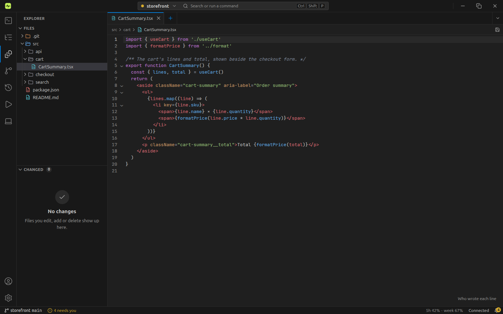
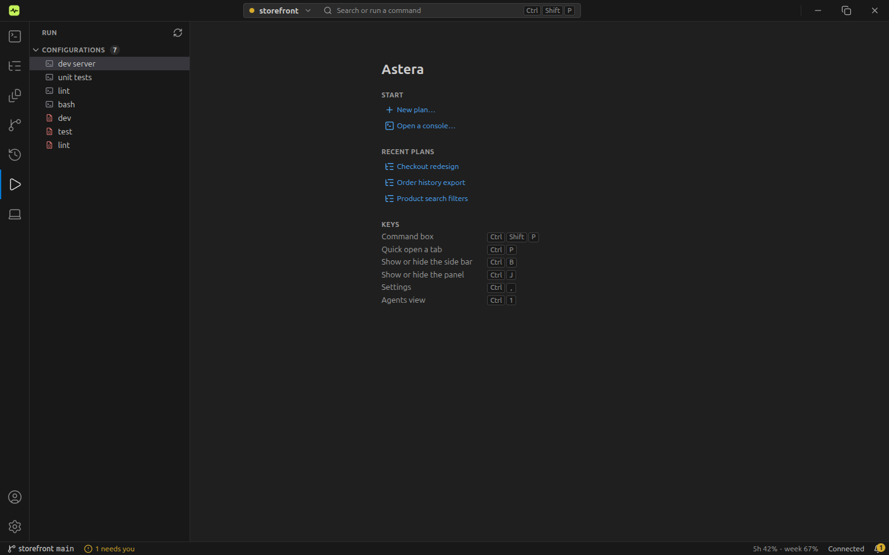
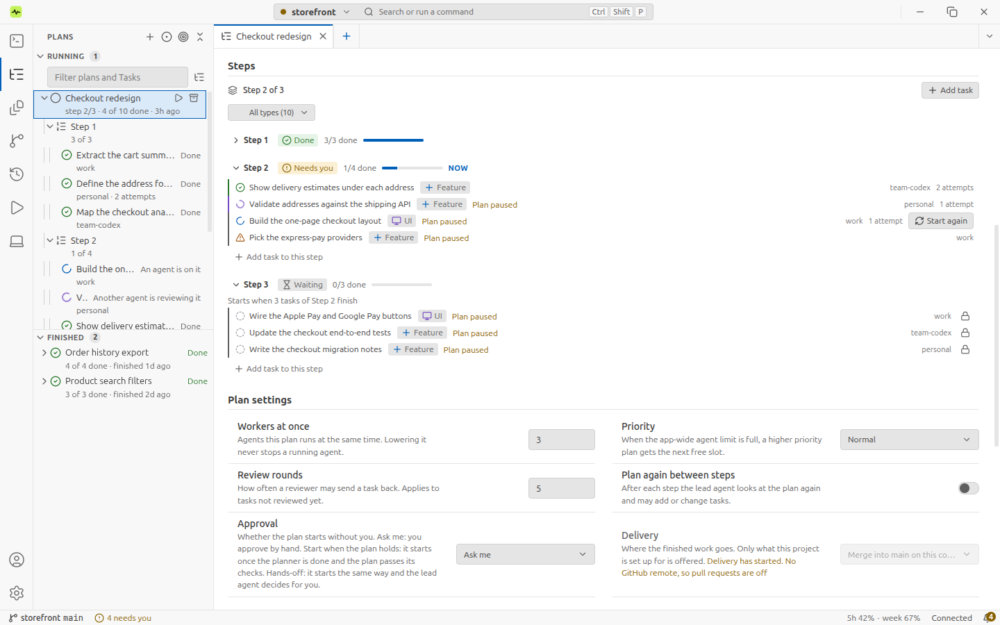

# Everyday usage guide

Start with one session, then add the features that fit your work. Astera runs your installed
Claude Code and Codex tools using your own accounts.

## Start a session

1. [Install Astera and your chosen CLI](../README.md#run-it).
2. Open **Accounts** (bottom of the activity bar, or the usage in the status bar), then use **Find signed-in accounts** to
   register an existing account, or **Add account** to create a separate account entry and complete its sign-in.
3. Open **New session** (`Ctrl+N`, or **Open a console** in the Agents view), choose your **Project folder** and **Account**, then choose
   **Terminal** or **Chat** and click **Start**.
4. Describe the result you want and how to check it. Answer questions and approvals as they arrive.

Terminal gives you the CLI interface. Chat gives you a message composer, question and approval
cards, and model and permission controls. Drop a file or paste an image into Chat to include its
path in your message. A session keeps the type it was created with; choose the default for new
sessions under **Settings → General → New sessions start as**.

## Reopen an earlier conversation

1. Open the **History** view in the activity bar (`Ctrl+5`) and find the conversation under **Sessions**.
2. Click a conversation to open its summary in a tab. Previewing does not start a session.
3. Use its **Resume session** button, choose a logged-in account, and click **Resume**.

If the project folder moved, select its current location when prompted. To bring back a project
hidden from the history list, use **Settings → History → Unhide**.

## Use multiple accounts

Register the accounts you need and sign in to each. In **New session**, pick the first account
and use **+ Add account** to set the rolling order. When a usage limit is reached, Astera can
continue on the next available account for the same service. Each account retains its own limits.

The animation shows rolling in the app:

With a single account, **Wait for the limit to reset, then resume automatically** controls waiting
and resuming. With multiple accounts, rolling is automatic; check the displayed reset time if
there is no available account to switch to.

When adding an account, **Import settings from the default account** can bring over its setup.
Review the import dialog: merge and replacement rules differ by file and provider, and imported
settings apply to new sessions rather than sessions already running.

**Smart Resume** is optional and experimental. Choose it under **Settings → Agents → Session
resume strategy** to give a new session a compact checkpoint when rolling moves work to another
account. If checkpoint creation fails, Astera falls back to ordinary resume.

## Schedule work and receive updates

In **New session**, enable **Scheduler**, choose an interval or a daily, weekly, or monthly rule,
then enter the command for Terminal or the prompt for Chat. Start the session to activate it.
Keep Astera running and the computer awake when you expect scheduled work to run.

For Slack updates, follow the [Slack bot setup](slack-bot-setup.md), then enable
**Slack progress notifications** for the session. Bot mode groups a session's updates in one
thread. Replies require Socket Mode and your configured Slack member ID; without that ID,
no member's replies reach the session. Telegram works the same way: see the
[Telegram bot setup](telegram-bot-setup.md).

For notifications on your computer, open **Settings → Notifications**. Choose alerts for
input needed, waiting on a limit, and account switches. Desktop alerts are sent when you are
looking at another session or window. In the app, the bell in the status bar lists what needs you, and
the bottom panel's **Needs you** tab holds the same items.

## Work with files and panes

Open the **Explorer** view (`Ctrl+3`) to browse files; its **Changed** pane lists the changed files of
the current worktree. A file opens as a tab. File tabs and session tabs share the editor groups;
split right or down to keep a file beside the session changing it. Use the bottom panel's **Terminal**
tab (`Ctrl+J`) for commands you want to run yourself.

A Markdown file can be shown as an editor, split editor/preview, or preview alone. Press
**Ctrl/Cmd + Shift + V** to cycle these modes. The split views follow each other's scrolling.

For a deletion captured by Astera, right-click in the explorer and choose **Local History…**.
Select the deleted item and click **Restore**. If its old path is already occupied, the restored
copy gets another name; check the reported path. Snapshots are kept for up to 30 days within the
project's size budget. Items over 50 MB are excluded, so a missing snapshot cannot be recovered
through this feature.

## Run a dev server, build, or test

Open the **Run** view (`Ctrl+6`) and run a configuration from its row (Run, Stop and Edit sit on the row). Astera detects supported project scripts
and tasks, including npm scripts and standard Gradle/Maven tasks. A detected configuration appears
in italics until you edit it and save it as your own.

Choose the appropriate configuration kind when adding one: Shell, npm, Node.js, Gradle, Maven,
cargo, go, Python, pytest, Docker Compose, Dockerfile, .NET, or Compound. Use its fields for that
tool rather than manually assembling every command. Read the bottom panel's **Output** tab for output and errors.

## Isolate work and open a pull request

1. In a git project with a commit and branch, enable **Start in a separate worktree** in
   **New session**. Choose the base branch if needed.
2. Make and review changes in that worktree.
3. Use the **Source Control** view's worktree list to see PR state. When the branch has commits its base does not have,
   its create-PR action can push the branch and open a pull request.

Astera uses your existing GitHub CLI (`gh`) login. Review the target branch and PR details in the
dialog before creating it.

## Give visual feedback with Design Mode

1. Open your web page in an Astera browser tab and turn on **Design Mode**.
2. Click an element, write what should change, and choose **Change** or **Question**.
3. Choose **Send to session** and select the session that should receive your notes.

Notes include the element's details and a cropped screenshot. You can keep up to twenty notes in
a tab. Design Mode turns off when the page navigates away.

To let the agent inspect the local app itself, enable the experimental **Agent browser** setting
and start a new session. Ask it to check the project's dev server; it can inspect pages, click
through a flow, and read console and network errors. This browser is restricted to local pages.

## Coordinate tasks and understand the results

- **Plans and Tasks:** use the **Plans** view (or **New**) for an objective with
  workers, dependencies, and completion checks. See [Jobs](jobs.md) for worktrees,
  repair attempts, manual merging, and the differences between normal and scheduled runs.
- **Change a running plan:** open the plan's tab and go to **Plan settings** (or choose
  **Edit plan settings…** in the Plans view's context menu). Workers at once, priority, review
  rounds, planning again between steps, auto-approve and hands-off can change while the plan runs;
  see [Change a running plan](guide.md#change-a-running-plan).
- **How It Works:** enable **Work unit tracking**, choose an **Explanation account**, and use
  `/astera-task` in a new session. See the [How It Works guide](how-it-works.md) for reading records,
  flow diagrams, decision sources, and verification results.

## Adjust appearance, language, and shortcuts

- **Settings → Appearance:** choose a theme and terminal font. Theme changes apply to open
  terminals without clearing their scrollback.
- **Settings → General → Language:** choose English, Korean, Japanese, Spanish, or System.
- **Settings → Shortcuts:** inspect and remap the controls (Settings opens as a tab with `Ctrl+,`). The defaults use Cmd on macOS and
  Ctrl on other systems.

| Action | Default shortcut |
| --- | --- |
| Agents, Plans, Explorer, Source Control, History, Run views | Ctrl/Cmd + 1 to 6 |
| Show or hide the side bar | Ctrl/Cmd + B |
| Show or hide the bottom panel | Ctrl/Cmd + J |
| Command palette | Ctrl/Cmd + Shift + P |
| Go to a tab, plan or file | Ctrl/Cmd + P |
| Settings | Ctrl/Cmd + , |
| Markdown display mode | Ctrl/Cmd + Shift + V |

## Check for an update

Open **Settings → Info → Check for updates** and follow the available download/install action.
Review the restart prompt before installing. Update support depends on the platform and build;
when an automatic update is unavailable, use the matching installer from
[GitHub Releases](https://github.com/JanoTheDev/astera-orchestrator/releases/latest) and follow the
[installation notes](../README.md#run-it).
